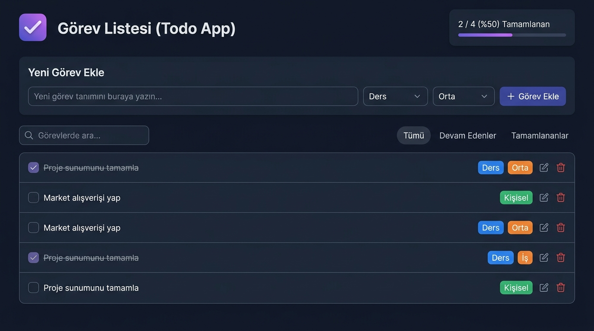

# 📝 TodoApp — Modern Görev Yönetim Uygulaması

Web Geliştirme Proje Yönergesi gereksinimlerine birebir uygun olarak geliştirilmiş; **ReactJS**, **TypeScript**, **Pure CSS** ve **LocalStorage** destekli modern, sade ve tam fonksiyonel bir Görev (Todo) yönetim uygulamasıdır.



---

## 📋 Proje Yönergesi ve Uyumluluk Tablosu

| Yönerge Maddesi | Durum | Açıklama |
|---|:---:|---|
| **Modern JS Kütüphanesi** | ✅ Tamamlandı | **ReactJS 19** + **TypeScript** + **Vite** mimarisi kullanıldı. |
| **LocalStorage Desteği** | ✅ Tamamlandı | Eklenen, düzenlenen veya silinen tüm görevler tarayıcının yerel hafızasında (`localStorage`) anlık saklanır. Sayfa yenilense de kaybolmaz. |
| **Netlify Yayına Alma** | ✅ Tamamlandı | `netlify.toml` ve `public/_redirects` SPA konfigürasyonu yapıldı, tek tıkla yayına hazır. |
| **Dosya Ağaç Yapısı** | ✅ Tamamlandı | Yönergede tavsiye edilen `Components`, `Pages` ve `Interfaces` klasör yapısı kuruldu. |
| **CSS Tercihi** | ✅ Tamamlandı | Harici kütüphane şişkinliği olmadan sıfırdan **Pure CSS (Vanilla CSS)** ve modern CSS Değişkenleri ile tasarlandı. |
| **CRUD: Ekleme (Create)** | ✅ Tamamlandı | `TodoForm` bileşeni üzerinden başlık, kategori (Ders, İş, Kişisel, Genel) ve öncelik derecesiyle yeni görev eklenir. |
| **CRUD: Listeleme (Read)** | ✅ Tamamlandı | `TodoFilter` ve `TodoItem` bileşenleri ile tüm görevler listelenir; duruma göre (Tümü, Devam Edenler, Tamamlananlar) filtrelenir ve canlı aranabilir. |
| **CRUD: Güncelleme (Update)** | ✅ Tamamlandı | Görev durumu tek tıkla "Tamamlandı" olarak işaretlenebilir; "Düzenle" butonu ile görev başlığı, kategorisi ve önceliği güncellenebilir. |
| **CRUD: Silme (Delete)** | ✅ Tamamlandı | İstenmeyen görevler "Sil" butonu ile kalıcı olarak kaldırılabilir. Ayrıca tamamlananlar topluca temizlenebilir. |
| **Ekran Görüntüsü** | ✅ Tamamlandı | `public/screenshots/dashboard_preview.jpg` dosyası eklendi. |
| **GitHub Entegrasyonu** | ✅ Tamamlandı | Git reposu hazırlandı ve commit'lendi. |

---

## 🛠️ Kullanılan Teknolojiler

- **Kütüphane:** React 19 (TypeScript ile)
- **Geliştirme & Derleme:** Vite 8
- **Stil & Tasarım:** Modern Pure CSS3 (CSS Variables, Flexbox, Yumuşak Geçişler)
- **İkon Seti:** Lucide React
- **Veri Depolama:** Tarayıcı Yerel Belleği (`window.localStorage`)

---

## 📁 Dosya ve Klasör Yapısı

```text
ai-task-master/
├── public/
│   ├── _redirects              # Netlify SPA yönlendirme kuralı
│   └── screenshots/
│       └── dashboard_preview.jpg  # Proje arayüz ekran görüntüsü
├── src/
│   ├── components/             # Yeniden kullanılabilir React bileşenleri
│   │   ├── Navbar.tsx          # Üst başlık, tamamlama oranı ve sıfırlama butonu
│   │   ├── TodoFilter.tsx      # Arama çubuğu ve durum filtre sekmeleri
│   │   ├── TodoForm.tsx        # Yeni görev ekleme formu (Create)
│   │   └── TodoItem.tsx        # Tekil görev kartı (Listeleme, Güncelleme, Silme)
│   ├── interfaces/             # TypeScript tip tanımları
│   │   └── todo.ts             # ITodo, TodoCategory, TodoPriority, FilterStatus
│   ├── pages/                  # Sayfa bileşenleri
│   │   └── TodoPage.tsx        # Ana sayfa ve CRUD durum (state) yönetimi
│   ├── utils/                  # Yardımcı fonksiyonlar
│   │   └── storage.ts          # LocalStorage okuma/yazma ve başlangıç verileri
│   ├── App.css                 # Temiz ve modern Pure CSS stilleri
│   ├── App.tsx                 # Kök React bileşeni
│   ├── index.css               # Global tipografi ve renk değişkenleri
│   └── main.tsx                # React DOM render noktası
├── netlify.toml                # Netlify yayına alma konfigürasyonu
├── package.json
└── tsconfig.json
```

---

## 🚀 Projeyi Bilgisayarınızda Çalıştırma

Projeyi yerel ortamda çalıştırmak için:

1. **Bağımlılıkları Yükleyin:**
   ```bash
   npm install
   ```

2. **Geliştirme Sunucusunu Başlatın:**
   ```bash
   npm run dev
   ```
   Tarayıcınızda açılan `http://localhost:5173` adresine giderek uygulamayı test edebilirsiniz.

3. **Üretim (Production) Derlemesi Alın:**
   ```bash
   npm run build
   ```

---

## 🐙 GitHub'a Yükleme Adımları

1. [GitHub](https://github.com/new) üzerinde oturum açın ve **ai-task-master** adında **Public** bir repository oluşturun (README veya .gitignore ekleme kutucuklarını işaretlemeyin).
2. Terminalinizde hazır olan projeyi doğrudan GitHub'a göndermek için tek komut yeterlidir:
   ```bash
   git push -u origin main
   ```
   *(Remote origin zaten `https://github.com/Farukydmr/ai-task-master.git` olarak tanımlanmıştır).*


---

## 🌐 Netlify Üzerinden Yayına Alma Adımları

1. [Netlify](https://www.netlify.com) hesabınıza giriş yapın.
2. **Add new site** > **Import an existing project** seçeneğine tıklayın.
3. **GitHub** sağlayıcısını seçin ve yukarıda yüklediğiniz depoyu seçin.
4. Ayarlar otomatik algılanacaktır:
   - **Build command:** `npm run build`
   - **Publish directory:** `dist`
5. **Deploy site** butonuna tıklayın. Birkaç saniye içinde siteniz canlıya alınacak ve size `.netlify.app` uzantılı bir bağlantı verecektir.
6. Bu linki ödev teslim formunuza ekleyebilirsiniz.
